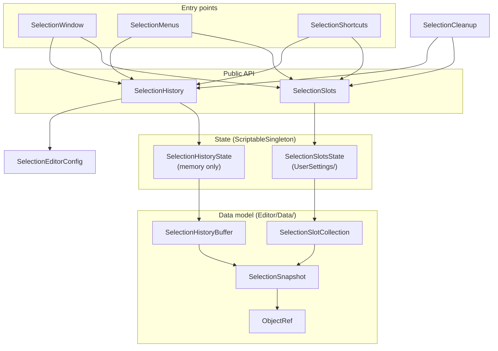

# Contributing

First of all, thank you for considering contributing to a *Sideways Experiments* project!

At Sideways Experiments, we hate doing the same thing more than once, and we love to share knowledge. Whether because you "just want to help" or share that generous laziness philosophy, you're welcome!

## Developer setup

This package is developed as part of an internal Unity project, where it (and our other packages) live under `Packages/` as Git submodules. You don't need that project to contribute, though: the package is self-contained and can be developed inside any Unity project.

### Requirements

- **Unity**: minimum supported version is **2021.3** (as defined in `package.json`'s `unity` field)
- **[SideXP Core](https://github.com/side-xp/unity-core)**: this package depends on it (see `package.json`'s `dependencies` field). Since it's not published on a registry, Unity can't fetch it automatically: install it in your project first, from its Git URL or as an embedded package.
- **Unity Test Framework** (`com.unity.test-framework`): required to run the tests (see [Tests](#tests) below).
- **.NET SDK 8.0+**: only required if you want to (re)generate the API documentation locally (see [Documentation](#documentation) below).
- **Python 3 + Zensical**: optional, only if you want to preview the documentation website locally.

### Getting the package into a Unity project

1. **Fork** and clone this repository.
2. Add it to a Unity project, either by:
    - cloning it into the project's `Packages/` folder (embedded package, recommended for development), or
    - referencing its Git URL from `Packages/manifest.json` (read-only, less convenient for editing).
3. Open the project in Unity. This package is **editor-only**: all of its code lives in the `Editor/` folder and is compiled into a single editor assembly (`SideXP.Unity.Selection`) through its `*.asmdef` file.

### Source layout

| Folder | Contents |
| --- | --- |
| `Editor/` | Editor-only code (this package ships no runtime assembly) |
| `Editor/Data/` | The serializable data model (object references, snapshots, history buffer, slots), with no dependency on editor events |
| `Editor/Config/` | The user preferences, and their page in the *Preferences* window |
| `Editor/GUI/` | The Selection window |
| `Tests/Editor/` | Edit mode tests, compiled into the `SideXP.Unity.Selection.Tests.Editor` assembly |
| `Documentation~/` | Documentation sources: guides, images and the Zensical config. The `~` suffix tells Unity to ignore this folder. |

### Documentation

The user documentation lives in `Documentation~/`, and is published as a website on GitHub Pages:

| File | Contents |
| --- | --- |
| `installation.md` | How to install the package and its dependencies |
| `guides/manual.md` | How to use the Selection window, the shortcuts, the menus and the preferences |
| `guides/recipes.md` | How to use the package from editor scripts |

The repo-root `README.md` only contains a short description, the features and links to the website. If your change affects how the package is used, please update the matching page.

The API reference under `Documentation~/api/` is **generated** from the C# source and is **not** committed (it's gitignored). It's produced by the [SideXP.Instadoc](https://www.nuget.org/packages/SideXP.Instadoc) CLI tool, which reads the source directly (no compilation, no DLL references needed).

To regenerate it locally:

```sh
# Install the tool once (global .NET tool)
dotnet tool install --global SideXP.Instadoc

# From the package root, generate the API docs into Documentation~/api/.
# This package is editor-only, so only the Editor/ folder is scanned (tests are not part of the API reference).
# Keep the --input folders in sync with the package's actual source folders (and with the release workflow).
instadoc \
  --input Editor \
  --output "Documentation~/api" \
  --grouping namespace \
  --exclude "**/*.Generated.cs"
```

The documentation site's index page, `Documentation~/README.md`, is **generated from the repo-root [`README.md`](./README.md)** so the two never drift, and is therefore **not committed** (it's gitignored). CI rebuilds it on every docs build. The root README carries a few HTML-comment markers that the build interprets:

- `<!-- docs:remove:start -->` … `<!-- docs:remove:end -->`: content shown only on GitHub (e.g. the "Complete documentation available at …" pointer), stripped from the docs site index.
- `<!-- docs:only:start` … `docs:only:end -->`: content hidden on GitHub (it sits inside the comment) and shown only on the docs site. This is used to swap repo-relative links (`./CONTRIBUTING.md`, `./LICENSE.md`) for absolute ones that resolve on the published site.

The build also rewrites links that point into `./Documentation~/` (used on GitHub to reach the docs from the repo root) so they resolve on the published site, where the index already lives at the `Documentation~/` root. That's why images are stored in `Documentation~/img/`, and referenced from the README as `./Documentation~/img/<file>` (or as `../img/<file>` from the pages in `Documentation~/guides/`).

The full documentation website (built from the Markdown files with [Zensical](https://zensical.org), using our [side-xp theme](https://github.com/side-xp/py-zensical-theme)) is assembled automatically in CI and deployed to GitHub Pages on each release. You don't need to build it to contribute. To preview it locally from the package root:

```sh
# Generate the index page from the root README (same transform CI runs)
sed -e '/<!-- docs:remove:start -->/,/<!-- docs:remove:end -->/d' \
    -e '/<!-- docs:only:start/d' \
    -e '/docs:only:end -->/d' \
    -e 's#\./Documentation~/#./#g' \
    README.md > "Documentation~/README.md"

pip install "git+https://github.com/side-xp/py-zensical-theme"
zensical serve -f "Documentation~/zensical.toml"
```

This serves the docs with live reload. To produce the static site instead, use `zensical build -f "Documentation~/zensical.toml"`, which writes it to the gitignored `Documentation~/site/` folder.

## Architecture

The package is organized in layers. Each layer only talks to the one below it, so the data model can be tested without any editor window or event involved.



### Data model

These classes are plain serializable classes. They don't listen to any editor event, and are the main target of the tests.

- **`ObjectRef`**: a reference to a single object, that can be resolved again after its original instance has been lost (see [Object resolution](#object-resolution) below).
- **`SelectionSnapshot`**: a list of `ObjectRef` (without duplicates) and the index of the active object. It can be applied to the editor selection with `Apply()`, which skips the objects that can't be resolved.
- **`SelectionHistoryBuffer`**: an ordered list of snapshots with a cursor on the current one. It behaves like a web browser history: `Push()` discards the entries after the cursor, and the oldest entries are trimmed beyond `MaxCount`.
- **`SelectionSlotCollection`**: a fixed-size list of slots. An unassigned slot holds an **empty snapshot** (not `null`), so the list serializes cleanly.

### State

The data is held by two `ScriptableSingleton`, so it survives domain reloads:

- **`SelectionHistoryState`** is not saved on disk: the history is reset when the editor is restarted.
- **`SelectionSlotsState`** is saved in `UserSettings/SideXP.Selection.SelectionSlots.asset`, since saved selections are personal. Only the identifiers of scene objects are written on disk, not the references themselves. If the saved data doesn't have `SelectionSlotCollection.DefaultCount` slots, it's resized when loaded.

### Public API

`SelectionHistory` and `SelectionSlots` are the static entry points used by the UI, the menus, the shortcuts, and by users' own scripts. **Every change to the history or the slots must go through them**, since they're responsible for:

- raising their `OnChanged` event (the window repaints on it),
- saving the slots on disk after each change (`SelectionSlotsState.SaveToDisk()`),
- logging a warning listing the objects that can't be selected when a selection is restored (`SelectionDisplayUtility.LogUnavailableObjects()`).

`SelectionHistory` is `[InitializeOnLoad]`, and records selections this way:

1. On `Selection.selectionChanged`, it marks a commit as pending and stores the time of the change.
2. On `EditorApplication.update`, it commits the selection once it has remained unchanged for `SelectionEditorConfig.CommitDelay`. This debounce is what turns a rectangle selection into a single entry.
3. Before going back or forward, it flushes the pending commit, so the current selection can be reached again with *Forward*.
4. When it applies an entry itself (`GoTo()`), it cancels the pending commit, so the resulting selection change is not recorded as a new entry.

### Cleanup

`SelectionCleanup` is `[InitializeOnLoad]` too, and keeps the recorded selections consistent with the loaded content:

- When a scene is opened, closed or created, and when entering edit or play mode, it schedules a single cleaning pass for the next editor update (opening a multi-scene setup triggers several events in a row). Cleaning removes the `Missing` objects, and the history entries that become empty.
- When a scene is saved, it refreshes all the references, so objects that were not saved before get a stable id.

### Entry points

- **`SelectionWindow`** (`Editor/GUI/`) is an IMGUI window. It **doesn't hold any data**: it only draws the state of `SelectionHistory` and `SelectionSlots`, and forwards user actions to them.
- **`SelectionMenus`** declares the `Tools > Sideways Experiments > Selection` menus. Priorities are spaced by more than 10 between groups, so Unity draws a separator between them.
- **`SelectionShortcuts`** declares the shortcuts, with ids prefixed by `Sideways Experiments/Selection/`. The window reads the current bindings with `SelectionShortcuts.GetBindingLabel()` to display them in its tooltips.
- **`SelectionEditorConfig`** and **`SelectionEditorConfigProvider`** (`Editor/Config/`) declare the user preferences, using the editor config system of the Core package (`EEditorConfigScope.User`).

## Object resolution

`ObjectRef` is the core of the package: most bugs related to "lost" or "wrong" objects come from there. When it's resolved, it tries, in this order:

1. **The cached reference**, as long as the original instance is still alive.
2. **Its `GlobalObjectId`**, for assets and objects saved in a scene. In play mode, scene objects skip this step, since their stable id targets their edit mode version.
3. **Its hierarchy path**, for scene objects (including objects not saved yet, or spawned in play mode). Each element of the path is stored as a name and an *occurrence* (its index among the siblings with the same name), so duplicate names can still be told apart. Components are identified the same way, by type and index among the components of the same type.

A scene object is only looked up if its scene is loaded. The scene is identified by GUID first, so it's still found after being moved or renamed, then by path for unsaved scenes.

`ObjectRef.GetState()` returns one of the `EObjectRefState` values, which drive the cleaning logic:

| State | Meaning | On cleaning |
| --- | --- | --- |
| `Resolved` | The object has been found | Kept, and refreshed if it doesn't have a stable id yet |
| `Unloaded` | The object has a stable id, but its scene is not loaded | Kept, since it can be resolved again once its scene is loaded |
| `Missing` | The object doesn't exist anymore, or can't be identified anymore | Removed |

> Note: `ObjectRef.Refresh()` captures the identifiers of an object again, but does nothing in play mode, so the stable ids captured in edit mode are not overwritten with ids that are not reliable once back to edit mode.

## Extending the package

### Adding a preference

1. Add a serialized field to `SelectionEditorConfig`, with a `[Tooltip]` (it's displayed in the *Preferences* window) and its default value.
2. Expose it with a public property that clamps invalid values.
3. Read it from `SelectionEditorConfig.I` where it's needed. The *Preferences* page is generated automatically by `SelectionEditorConfigProvider`.
4. Add it to the *Preferences* table of the [manual](./Documentation~/guides/manual.md#preferences).

> Note: avoid reading the config on every editor update. For example, `SelectionHistory` reads `CommitDelay` only when the selection changes, and applies `HistoryMaxCount` only when committing a new entry.

### Adding a shortcut

Declare it in `SelectionShortcuts`, with an id built from the `ShortcutPrefix` constant. If the action is also available from the window, use `MakeContent()` in `SelectionWindow` so its tooltip displays the current binding. Then add it to the *Keyboard shortcuts* table of the [manual](./Documentation~/guides/manual.md#keyboard-shortcuts).

### Changing the number of slots

The number of slots is defined by `SelectionSlotCollection.DefaultCount`, and matches the number keys of a keyboard. If you change it, keep in mind that:

- the `[Shortcut]` attribute only accepts constant ids, so `SelectionShortcuts` declares one method per slot: you'll have to add or remove them by hand,
- `SelectionWindow` labels the slots after the number keys (the 10th slot being labelled *0*),
- the slots saved on disk by users are resized automatically when loaded (extra slots are discarded),
- the [manual](./Documentation~/guides/manual.md) and the README mention the number of slots and their shortcuts.

## Tests

The tests live in `Tests/Editor/`, and are compiled into the `SideXP.Unity.Selection.Tests.Editor` assembly. That assembly is only compiled when the `UNITY_INCLUDE_TESTS` define is set, which is the case when the Unity Test Framework is installed in the project. The main assembly declares it with `[InternalsVisibleTo]` (see `Editor/AssemblyInfo.cs`), so tests can use internal members.

To run them, open the *Test Runner* window (`Window > General > Test Runner`), select the *EditMode* tab, and run the tests under `SideXP.Unity.Selection.Tests.Editor`.

> Note: if you referenced the package from its Git URL instead of embedding it, its tests are not listed by default. Add `"com.side-xp.selection"` to the `testables` array of your project's `Packages/manifest.json` to make them visible.

When writing tests:

- Tests that create GameObjects must inherit from **`SceneTestsBase`**. It destroys the created objects on teardown, and ignores the tests if the active scene is a saved one, so tests never alter a user scene. Create objects with `CreateGameObject()`.
- To simulate the loss of an object's original instance (like after a domain reload) without destroying it, call `ObjectRef.ClearCache()`: the next resolution will use the stored identifiers.
- Prefer testing the data model (`ObjectRef`, `SelectionSnapshot`, `SelectionHistoryBuffer`, `SelectionSlotCollection`) and `SelectionDisplayUtility` directly, rather than the static `SelectionHistory` and `SelectionSlots` classes, which share state with the editor.

### Manual testing checklist

Some behaviors depend on the editor lifecycle and can't be covered by automated tests. If your change touches object resolution, recording or cleaning, please check these scenarios by hand before submitting it:

- [ ] A rectangle selection in the *Scene* view produces a single history entry.
- [ ] Going back then selecting something new discards the "forward" entries.
- [ ] The history and the slots survive a script recompilation.
- [ ] The slots survive an editor restart, and their scene objects are resolved again.
- [ ] Objects of a scene that is not loaded are greyed out, skipped with a warning when restored, and can be selected again once that scene is loaded (also with multiple scenes loaded additively).
- [ ] Objects created in an untitled scene can be selected again after that scene has been saved, and are removed if the scene is closed without saving.
- [ ] Objects spawned in play mode can be navigated during the play session, and are removed once back to edit mode.
- [ ] Renaming or moving a saved scene doesn't break the references to its objects.

## Get involved!

There are many ways to be involved in our open source projects, and there's absolutely no pressure to give more or less of your time. So whether you want to develop the core of a whole package or just post a comment in an issue, any help is appreciated!

So what can you do to help?

- **Discuss with the community**: join our [Discord server](https://discord.gg/G49RUZ9F2N), and start chatting with the community or the core team
- **Report bugs**: found a bug when using one of our packages? You can report it in the *Issues* tab on GitHub
- **Suggest improvements**: whether from the [Discord server](https://discord.gg/G49RUZ9F2N) or by creating an *Issue*, feel free to talk about your needs or current usage of our solutions, highlight what's missing or what could be better
- **Request new features**: again, you can use the [Discord server](https://discord.gg/G49RUZ9F2N) or create a new *Issue* to ask for something new, see if others may need it too, so we can consider modifying an existing package or even start a new project just for it
- **Address issues**: you can contribute directly to the codebase by resolving an issue, creating the required assets, or just implementing changes and create a Pull Request on *GitHub*

> By the way, we love to know how you use our tools, so we can make them better!

## Code of Conduct

*Sideways Experiments* has adopted the [*Contributor Covenant*](https://www.contributor-covenant.org/) as its Code of Conduct for its open source projects, and we expect contributors to adhere to it.

If you observe any unacceptable behavior or need to report a violation, please contact the *Sideways Experiments* core team directly to [contact@sideways-experiments.com](mailto:contact@sideways-experiments.com).

## Code syntax

Please refer to our [general Coding Style specification](https://github.com/side-xp/.github/blob/main/docs/coding-style/README.md) to learn more about the conventions used in this project.

A few things specific to this package:

- The package's namespace is `SideXP.Selection`, which shadows `UnityEditor.Selection` inside the package code. Use the `UnitySelection` alias (`using UnitySelection = UnityEditor.Selection;`) to reach Unity's selection API.
- Classes are split into regions (`Fields`, `Lifecycle`, `Public API`, `Internal API`, `Private API`, ...), and every member has at least a `<summary>` XML comment, since the API reference is generated from them.

## Submitting a Pull Request

To contribute code:

1. **Fork** this repository
2. Create a **new branch** off `develop`
3. Make your changes and commit them
   - **Signed commits** are required
   - Take care to follow our [commit message guidelines](https://github.com/side-xp/.github/blob/main/docs/coding-style/commit-messages.md)
4. Test your changes locally (run the [tests](#tests), and go through the [manual testing checklist](#manual-testing-checklist) if relevant)
5. Submit a **Pull Request targeting `develop` or `dev`**, not `master` or `main`
6. Describe your changes and reference any related issues
7. A member of the ***Sideways Experiments* core team** will review it

As mentioned in the [*Suggesting enhancements or features*](https://github.com/side-xp/.github/blob/main/SUPPORT.md#suggesting-enhancements-or-features) section of our support guidelines, please don't create Pull Requests for unsolicited work.

### Pull Request Requirements

- One PR per logical change (fix, feature, etc.)
- Must pass the package's tests
- Must use **signed commits**
- All PRs must be reviewed by a *Sideways Experiments* core team member
- Assign the PR to the core team if not automatically assigned

## Releases

Releases are fully automated and handled internally (contributors don't need to do anything special beyond writing good commit messages).

We use [Conventional Commits](https://www.conventionalcommits.org/) together with [Release Please](https://github.com/googleapis/release-please):

1. When commits land on `main` (or `master`), **Release Please** opens and maintains a "release PR" that bumps the version in `package.json` and updates `CHANGELOG.md`, based on the commits since the last release:
    - `fix:` → patch (`x.y.Z`)
    - `feat:` → minor (`x.Y.z`)
    - `feat!:` or a `BREAKING CHANGE:` footer → major (`X.y.z`)
2. When the core team merges that release PR, a Git tag and a **GitHub Release** are created automatically.
3. The same **Release** workflow then:
    - generates the API documentation from the source,
    - builds and deploys the documentation website to GitHub Pages,
    - attaches these assets to the Release:
        - `<package-name>.zip` / `<package-name>.tar.gz` (where `<package-name>` is the `name` field from `package.json`): the package source,
        - `Documentation_vX.Y.Z.zip`: a snapshot of the full Markdown documentation (including the generated API reference) for that exact version.

Because the version is derived from commit history, **following our [commit message guidelines](https://github.com/side-xp/.github/blob/main/docs/coding-style/commit-messages.md) is what drives the next version number**, so please take care with them.

> Note: changing how selections are saved on disk (the serialized fields of `SelectionSlotsState`, `SelectionSnapshot` or `ObjectRef`) may discard the slots users already saved. Treat it as a breaking change, unless you handle the migration of the existing data.

## License and Contributor Agreement

Most of our projects are licensed under the [MIT License](https://mit-license.org).

A `LICENSE.md` file is always included in our projects' repository root, and all contributions to a specific project will be licensed under the same terms as that file.

We will evaluate whether a Contributor License Agreement (CLA) is required in the future, as the projects go. For now, you can contribute freely under MIT.

## Maintainers

This project is maintained by the team at *Sideways Experiments*.

If you're unsure about any part of the contribution process, feel free to open a discussion on our [Discord server](https://discord.gg/G49RUZ9F2N), or by sending an email directly to [contact@sideways-experiments.com](mailto:contact@sideways-experiments.com).

---

Thank you again for being part of the project!
