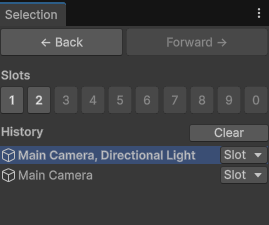
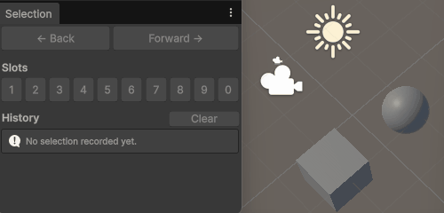
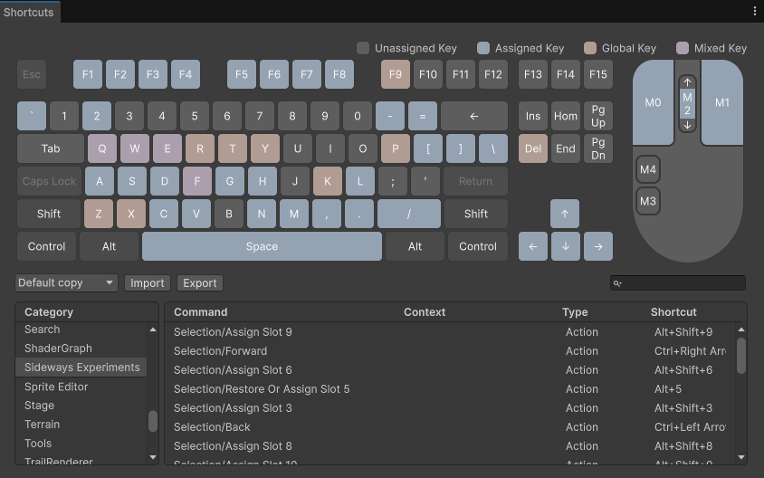
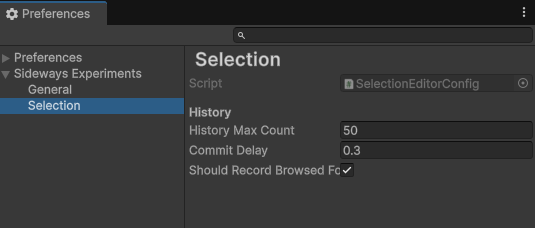

# Manual

This package lets you navigate through your previous selections, and save the selections you use the most in numbered slots. Everything is available from the Selection window, the keyboard shortcuts and the main toolbar menus.

## The Selection window

> `Tools > Sideways Experiments > Selection > Selection Window`

The window is made of three parts:

- **Back / Forward** buttons, to navigate through the selection history
- **Slots**: one button per slot, labelled from *1* to *0* to match the number keys of your keyboard. Assigned slots are displayed in bold, and hovering a slot lists the objects saved in it.
- **History**: the recorded selections, from the most recent to the oldest. The current one is highlighted. Click an entry to select it again, or use its *Slot* button to save it in a slot.

Slots and history entries whose objects can't be selected right now (for example because their scene is not loaded) are greyed out.

## Navigating the selection history

Each time the selection changes, it's recorded as a new entry in the history. Use the *Back* and *Forward* buttons of the window, the [menus](#menus) or the [shortcuts](#keyboard-shortcuts) to move through it.

A few things to know about how selections are recorded:

- Empty selections are not recorded.
- A selection is recorded only once it has remained unchanged for a short delay (see [Preferences](#preferences)). That way, interactions that change the selection many times in a row (like a rectangle selection in the *Scene* view) result in a single entry.
- Just like in a web browser, selecting something new after going back discards the "forward" entries.
- The history survives script recompilations, but it's reset when the editor is restarted.

## Using selection slots

- **Click an empty slot** to save the current selection in it.
- **Click an assigned slot** to restore its selection.
- **Right-click a slot** to restore it, replace its content with the current selection, or clear it.
- From the history list, use the *Slot* button of an entry to save that selection in a slot without having to select it first.

Slots are saved in the `UserSettings/` folder of your project. They're kept between editor sessions, and they're personal: they're not shared with your team through version control.

## Keyboard shortcuts

| Action | Default shortcut |
| --- | --- |
| Go back to the previous selection | `Ctrl + Left Arrow` (`Cmd + Left Arrow` on macOS) |
| Go forward to the next selection | `Ctrl + Right Arrow` (`Cmd + Right Arrow` on macOS) |
| Restore a slot (or save the current selection in it if it's empty) | `Alt + 1` to `Alt + 9`, and `Alt + 0` for the 10th slot |
| Save the current selection in a slot (replacing its content if any) | `Alt + Shift + 1` to `Alt + Shift + 9`, and `Alt + Shift + 0` for the 10th slot |

> On macOS, `Alt` is the `Option` key.

All these shortcuts can be rebound from the *Shortcuts* window (`Edit > Shortcuts`), under the *Sideways Experiments > Selection* category. The tooltips of the Selection window always display the current bindings.

> Note: the slot shortcuts don't conflict with Unity's own selection slots (`Edit > Selection > Load Selection` and `Save Selection`), which use different modifiers.

## Menus

> `Tools > Sideways Experiments > Selection`

The same actions are available from the main toolbar:

- **Selection Window**: opens the Selection window
- **Back** / **Forward**: navigates through the selection history
- **Clear History**: removes all the entries of the history, except the current selection
- **Clear All Slots**: unassigns all the slots (after confirmation, since it can't be undone)

## Preferences

> `Edit > Preferences > Sideways Experiments > Selection` (`Unity > Settings` on macOS)

These settings are personal preferences, stored on your machine only.

| Setting | Default | Description |
| --- | --- | --- |
| History Max Count | 50 | The maximum number of selections recorded in the history. The oldest ones are discarded when this limit is exceeded. |
| Commit Delay | 0.3 | The delay (in seconds) during which a selection must remain unchanged before being recorded in the history. |

## Scene objects and unloaded scenes

Recorded selections don't just keep a reference to your objects: they also keep what's needed to find them again after a domain reload, a scene reload, a switch between edit and play mode, or an editor restart.

- If some objects of a selection are in a scene that is not loaded, they're skipped when you restore that selection, and a warning in the *Console* tells you which scene to load. Once that scene is loaded, they can be selected again.
- Objects that don't exist anymore (deleted objects, objects of an unsaved scene that has been closed, objects spawned in play mode once back to edit mode, ...) are removed from the history and the slots automatically.
- Objects spawned during a play session can be selected again until you exit play mode.
