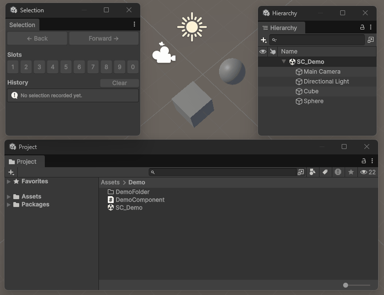

# SideXP - Selection (Unity)

Navigate back and forth through your previous selections, and save the selections you use the most in numbered slots, so you can get them back with a single shortcut.

All from a single window: `Tools > Sideways Experiments > Selection > Selection Window`

## Features

- **[Selection history](https://side-xp.github.io/unity-selection/guides/manual/#navigating-the-selection-history)**: every selection you make in the editor is recorded, so you can go back to a previous selection (or forward again) at any time.
- **[Selection slots](https://side-xp.github.io/unity-selection/guides/manual/#using-selection-slots)**: save up to 10 selections in numbered slots, and restore them with a click or a shortcut. Slots are personal and kept between editor sessions.
- **[Scene objects support](https://side-xp.github.io/unity-selection/guides/manual/#scene-objects-and-unloaded-scenes)**: works with assets and scene objects, even through domain reloads, scene reloads and play mode switches. Objects in scenes that are not loaded are selected again as soon as their scene is loaded.
- **[Keyboard shortcuts](https://side-xp.github.io/unity-selection/guides/manual/#keyboard-shortcuts)** for everything, rebindable from the *Shortcuts* window.
- **[Customizable](https://side-xp.github.io/unity-selection/guides/manual/#preferences)** from the *Preferences* window.
- **[Scripting API](https://side-xp.github.io/unity-selection/guides/recipes/)**: use the history and the slots from your own editor tools.

## Documentation & Help

<!-- docs:remove:start -->
Complete documentation available at https://side-xp.github.io/unity-selection

<!-- docs:remove:end -->
- [Installation](https://side-xp.github.io/unity-selection/installation/): how to add this package (and its dependency to our [Core library](https://github.com/side-xp/unity-core)) to your project
- [Manual](https://side-xp.github.io/unity-selection/guides/manual/): how to use the Selection window, the shortcuts, the menus and the preferences
- [Recipes](https://side-xp.github.io/unity-selection/guides/recipes/): how to use the package from your own editor scripts

If you need help or just want to chat with the community and the *Sideways Experiments* core team, you're welcome to join our [Discord server](https://discord.gg/G49RUZ9F2N)!

## Contributing

<!-- docs:remove:start -->
Do you want to get involved in our projects? Check our [contributing guidelines](./CONTRIBUTING.md) to learn more!
<!-- docs:remove:end -->
<!-- docs:only:start
Do you want to get involved in our projects? Check our [contributing guidelines](https://github.com/side-xp/unity-selection/blob/main/CONTRIBUTING.md) to learn more!
docs:only:end -->

## License

<!-- docs:remove:start -->
This project is licensed under the [MIT License](./LICENSE.md).
<!-- docs:remove:end -->
<!-- docs:only:start
This project is licensed under the [MIT License](https://mit-license.org).
docs:only:end -->

---

Crafted and maintained with love by [Sideways Experiments](https://sideways-experiments.com)

(c) 2022-2026 Sideways Experiments
